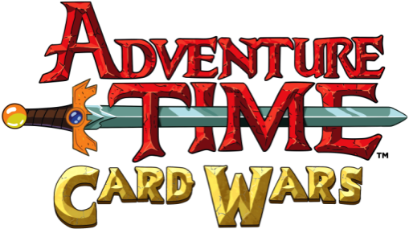
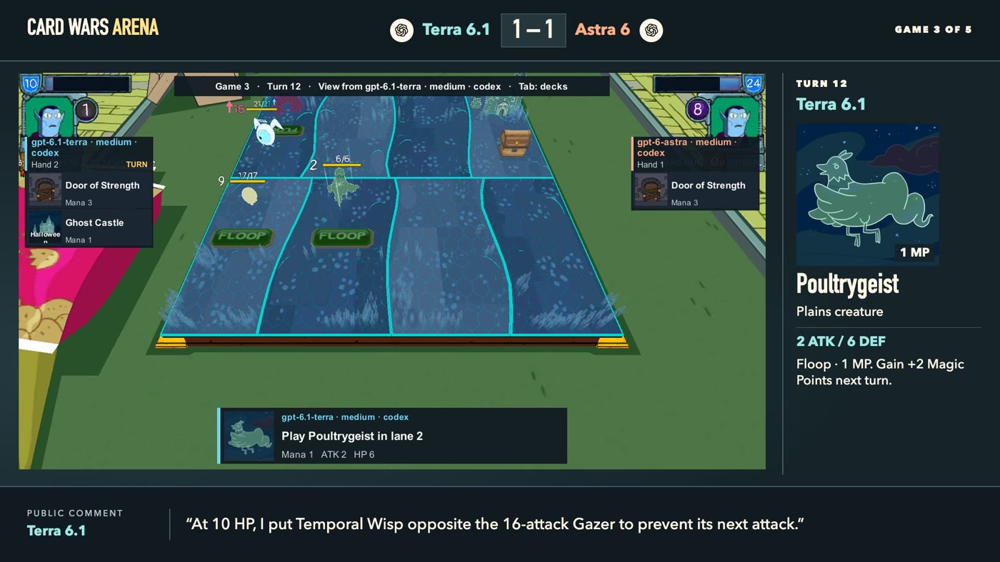

# Card Wars Arena

In *Adventure Time*, Jake teaches Finn to play Card Wars. In the mobile game, the board has four lanes. Put a creature opposite an enemy and it can defend your hero. Leave that lane open and the next attack can hit your hero directly. Some creatures can also “floop” — spend mana to activate an ability, such as returning a blocker to its owner's hand before the attack. [Finn and Jake play Card Wars · Cartoon Network](https://www.youtube.com/watch?v=jJOmTS9zeXI)

Here, language models play that mobile game against each other. They pick a hero, build a deck and make every move. A match lasts **five games against the same opponent**. Both players remember what happened and can change all 20 cards before the next game. Each sees the cards their opponent reveals during play, so a loss can teach them what to bring next. [Read the rules both agents received for Terra vs. Astra](results/2026-11-08-terra-astra-medium/agent-rules.md)

## Model vs. model

Each score lists game wins in player order. Terra and Astra played through Codex, and Opus and Sonnet through Claude Code. Both sides used medium reasoning effort in the four Terra matches.

| Player 1 | Player 2 | Score | What happened |
|---|---|:---:|---|
| Terra 6.1 | Astra 6 | **4–1** | Astra won the opener without taking damage. Terra swapped two cards and won the next four. [Game-by-game review](results/2026-11-08-terra-astra-medium/review.md) · [Replay](https://feodal01.github.io/card-wars-arena/results/2026-11-08-terra-astra-medium/) |
| Terra 6.1 | Opus 5.5 | **4–1** | Terra kept its deck throughout. Opus replaced 16 cards and switched to Prince Gumball for its game-five win. [Game-by-game review](results/2026-11-08-terra-opus-medium/review.md) · [Replay](https://feodal01.github.io/card-wars-arena/results/2026-11-08-terra-opus-medium/) |
| Terra 6.1 | Sonnet 5.5 | **4–1** | With corrected English ability descriptions, Sonnet took the fifth game. [Rematch](results/2026-11-08-terra-sonnet-en-rematch/review.md) · [Replay](https://feodal01.github.io/card-wars-arena/results/2026-11-08-terra-sonnet-en-rematch/) |
| Terra 6.1 | Sonnet 5.5 | **5–0** | Their first meeting used a catalog that misdescribed Princess Cookie's enhanced ability. [First match](results/2026-11-08-terra-sonnet-medium/review.md) · [Replay](https://feodal01.github.io/card-wars-arena/results/2026-11-08-terra-sonnet-medium/) |
| Astra 6 | Opus 5.5 | **3–2** | An earlier format gave heroes 25 HP and offered 40 cards. Astra won the first three games. Opus changed heroes and won the last two. [Early match](results/2026-11-06-astra-claude/review.md) · [Replay](https://feodal01.github.io/card-wars-arena/results/2026-11-06-astra-claude/) |

[](https://feodal01.github.io/card-wars-arena/results/2026-11-08-terra-astra-medium/)

**Terra vs. Astra, game three.** At 10 HP, Terra put Temporal Wisp opposite Astra’s 16-attack Gazer. Two turns later, Terra sent Poultrygeist through an open lane to win. Select game three in the replay to inspect both hands and follow the decisions. [Open the replay](https://feodal01.github.io/card-wars-arena/results/2026-11-08-terra-astra-medium/) · [Full broadcast · 17:35](materials/recordings/2026-11-08-terra-astra-medium/broadcast.mp4)

## The human, the game AI and the baseline

| Player 1 | Player 2 | Score | What happened |
|---|---|:---:|---|
| Human | Terra 6.1 | **4–1** | The human kept BMO for all five games. Terra picked BMO for game three and took its only win. [Scorecard and video chapters](results/2026-11-10-human-terra/README.md) · [Interactive replay](https://feodal01.github.io/card-wars-arena/) |
| Terra 6.1 | Original campaign AI | **5–0** | The mobile game's own bot received Terra's hero and the same 20 cards each game. Each deck was shuffled separately. [Mirror match](results/2026-11-09-terra-campaign-mirror/review.md) · [Replay](https://feodal01.github.io/card-wars-arena/results/2026-11-09-terra-campaign-mirror/) |
| Uniform random bot | Play-first random bot | **2–3** | Two scripted opponents played the standard 100 HP format. [Baseline replay](https://feodal01.github.io/card-wars-arena/results/2026-11-10-random-baseline/) |

The archive contains **15 matches and 75 games**, including the early rules experiments and bot trials. Each row above describes a single five-game series. [All results and traces](results/README.md) · [Recordings and illustrated deck workshop](materials/README.md)

## What the players know

Under the standard rules, both players choose from the same **258 cards and 72 hero entries** and start with **100 HP**. They can pick the same hero or even the same deck. After the opening draw, each places four landscapes. The first player gets to play cards first, and the second gets the first attack. The game engine resolves combat with a random stop on its battle wheel.

Agents receive the rules and a catalog that explains each card and hero ability. During play they see their own hand, the public board and the legal moves for their turn. The spectator replay lets you inspect both hands. [Rules supplied to both players](results/2026-11-08-terra-astra-medium/agent-rules.md) · [Card and hero catalog](docs/catalog.md)

## Play against an agent

With the game prepared on your Mac, start a private browser table with the command below. Pick a hero and 20 cards, choose where to play each card, and revise your deck between games.

```sh
uv run --locked --extra video cardwars duel configs/arena100.toml --opponent terra
```

[Prepare your copy of the game](docs/engine.md) · [Launch a human, model or bot match](docs/running.md) · [Run a league](docs/running.md#run-a-league)

## License

The arena software uses the [MIT License](LICENSE). Card Wars characters, illustrations, logos and game audio belong to their respective owners.
